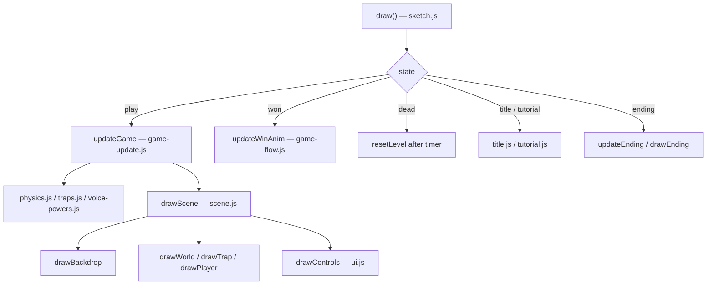

# Larp Devil (Level Devil: Sound Edition) — Documentation

A browser platformer built on [p5.js 1.9.4](https://p5js.org/) (global mode). Levels are full of traps that react to what you do, and some mechanics are controlled by sound (humming/voice via the microphone, or the `H` key as a fallback). There is no build step: every `.js` file is loaded by a `<script>` tag in [index.html](index.html) and shares one global scope.

## Running the project

| Method | How |
| --- | --- |
| Local dev server (live reload) | `node dev-server.js` then open `http://localhost:8000` (`PORT` env var overrides the port) |
| Any static server | Serve the project root. Don't open via `file://`, because the MP3 assets and microphone access need `http(s)://` |
| p5 Web Editor | Upload every file, keeping the `js/` and `assets/` folders. Binary assets (MP3, PNG, SVG) must be added with **Upload file**, not pasted. Make sure `index.html` loads the scripts in the order below |

## Controls

| Input | Action |
| --- | --- |
| `←` `→` / `A` `D` | Move |
| `↑` / `W` / `Space` | Jump (also climbs ladders) |
| `↓` / `S` | Climb down ladders |
| `Shift` | Sprint (uses stamina) |
| `H` (hold) | Manual hum (fallback for the microphone) |
| `R` | Retry the level |
| `Esc` | Close the settings panel / leave a tutorial screen |
| `Enter` / `Space` | Confirm on title, tutorial and ending screens |
| Click/tap | UI buttons (voice setup, retry, settings gear, title selectors) |

## Architecture

### Game states

`state` (declared in [js/state.js](js/state.js)) drives which update and draw path `draw()` runs:

`title` → `tutorialControls` → `tutorialAudio` → `play` ⇄ `dead` / `won` → … → `ending`

`draw()` in [js/sketch.js](js/sketch.js) computes a clamped `dt`, runs the update for the current state, applies the view transform (`translate(0, view.oy); scale(view.s)`), and calls the matching draw function.

### Script load order

Classic scripts share globals, so **order matters for load-time initializers** (for example `state.js` uses constants from `levels.js`). Function declarations are only called at runtime, so their relative order is free. `sketch.js` is last.

| # | File | Responsibility |
| --- | --- | --- |
| 1 | [levels.js](js/levels.js) | Constants (`W`, `H`, physics, stamina, `SKINS`, colour palette `C`) and `buildLevel(i)` for the 12 level definitions |
| 2 | [audio.js](js/audio.js) | Sound effects, background music, microphone/FFT processing, hum calibration, time-freeze/rewind ability timing |
| 3 | [state.js](js/state.js) | All shared mutable game state (`level`, `player`, `state`, particles, theme/skin, stamina, win-animation vars, `view`) and win-animation timing constants |
| 4 | [stamina.js](js/stamina.js) | `skin()`, `updateStamina`, `updateSprintCarry`, `updateCamera` |
| 5 | [storage.js](js/storage.js) | `GameStorage`: safe `localStorage` wrapper (`get`, `set`, `getNum`, `getBool`) |
| 6 | [input.js](js/input.js) | `activeKeys` tracking via native `keydown`/`keyup`, focus grabbing, `keyAny()`, key helpers |
| 7 | [voice-powers.js](js/voice-powers.js) | `handleVoicePowers`: hum-driven time freeze and rewind |
| 8 | [physics.js](js/physics.js) | Moving platforms, ladders, door-mode physics, platform collisions, footsteps, crumbling platforms |
| 9 | [game-update.js](js/game-update.js) | `updateGame` (main per-frame gameplay step), gate relocation, exit switch, `isSolid` |
| 10 | [traps.js](js/traps.js) | Trap triggers and per-type updates (chase wall, pop, fall, saw, laser, spring, vanish, fake) plus `updateTraps` |
| 11 | [game-flow.js](js/game-flow.js) | Geometry helpers (`overlap`, `circleRect`), `die`, `win`, win animation, ending transition, particles, `showMessage` |
| 12 | [time-overlays.js](js/time-overlays.js) | Time-freeze and rewind overlays and HUD |
| 13 | [scene.js](js/scene.js) | `drawScene`: composes the in-game frame |
| 14 | [title.js](js/title.js) | Title screen, skin/theme pickers, `startGame` |
| 15 | [tutorial.js](js/tutorial.js) | Controls tutorial and audio (voice) tutorial |
| 16 | [ending.js](js/ending.js) | Ending scene construction and rendering |
| 17 | [backdrop.js](js/backdrop.js) | `buildBackdrop`, `loadArtwork`, image cache/blit helpers, `drawBackdrop` |
| 18 | [world-render.js](js/world-render.js) | `drawWorld` (platforms, doors, exit), `drawCharacterMessage`, `drawLadder`, `drawPlayer` |
| 19 | [traps-render.js](js/traps-render.js) | Per-trap draw functions and `drawTrap` dispatcher |
| 20 | [ui.js](js/ui.js) | HUD (`drawControls`), `drawSettingsPanel`, `uiButton` |
| 21 | [events.js](js/events.js) | p5 handlers: `mousePressed`, `touchStarted`, `keyPressed`, `keyReleased`, `clickAt` |
| 22 | [sketch.js](js/sketch.js) | Entry point: `setup`, `draw`, `windowResized`, `layout`, `resetLevel`, `controlled` |

`js/p5.min.js` is a local copy of p5 that `index.html` doesn't use. It loads p5 1.9.4 from the CDN.

### Frame flow



### Input design

- Native `keydown`/`keyup` listeners (capture phase, in `input.js`) fill `activeKeys` with the key code, `e.code` and `e.key` variants. `keyAny(...)` checks that set. It deliberately does **not** call p5's `keyIsDown()`, which warns when given a non-number.
- `mousePressed()` and `touchStarted()` return `false`, which makes p5 call `preventDefault()` and stops the browser from moving focus into the frame. To work around this, `input.js` also grabs focus on `pointerdown`, `mousedown`, `touchstart`, `pointerup`, `mouseup` and `click`.
- `draw()` shows a "CLICK GAME TO ACTIVATE CONTROLS" overlay while `document.hasFocus()` is false.

### p5 accessibility grid workaround

`setup()` in `sketch.js` replaces `p5.prototype._updateGridOutput`, `_updateTextOutput` and `_updateAccsOutput` with no-ops. p5 1.9.4's accessible grid ignores `translate()` and crashes with negative grid indices for sprites drawn at negative local coordinates, such as doors and the player. **Side effect:** p5's screen-reader grid/text output is disabled.

### Persistence

`GameStorage` stores these keys: `larpdevil.skin`, `larpdevil.theme`, `larpdevil.natureUnlocked`, `larpdevil.musicEnabled` and other settings. It falls back safely if `localStorage` is unavailable.

## Assets

```
assets/
  audio/   background-music.mp3, glass-breaking.mp3, good.mp3, ladder.mp3, new-msg.mp3
  images/  gear.svg, hell.png, nature.png
```

If `hell.png` or `nature.png` is missing, the game falls back to a procedural backdrop and ending scene (a console warning is logged). A missing `gear.svg` only logs an error.

### Voice Powers & Rewind Design

- **Time Freeze (Pause):** Freezes trap movement and world simulation while humming (or holding `H`), allowing the player to sprint past hazards safely.
- **Time Rewind (Reverse):** Stepping into surprise traps or sudden hazards can be reversed! The world (traps, moving platforms, crumbling floors, gates) runs backward in time by up to 2 seconds, while the **player is NOT rewound and remains completely movable**, free to run, jump, reposition, or dodge away from incoming danger.
- **Emoji Free:** The UI, HUD banners, and tutorial avoid all emoji glyphs in favor of clean procedural icons and typography.

## Temporary diagnostics

- `state.js` logs a `[LevelDevil] sketch.js build: …` line on load.
- `setup()` has the temporary green on-screen badge (`v3 focus:… key:…`) commented out; it can be re-enabled if keyboard focus debugging is ever needed again.

## Adding or changing things

| Task | Where |
| --- | --- |
| New level or trap placement | `buildLevel(i)` in `levels.js` |
| New trap type | Add `update<Name>Trap` in `traps.js` and the `draw<Name>Trap` renderer in `traps-render.js`. Register both in the dispatchers `updateTraps` and `drawTrap` |
| Tune movement or stamina | Constants at the top of `levels.js` |
| New key binding | `keyAny(...)` call sites in `game-update.js` for gameplay, `keyPressed` in `events.js` for discrete presses |
| New shared state variable | `state.js` |
| New script file | Create it in `js/`, then add its `<script>` tag to `index.html` **before** `sketch.js`, in dependency order |

## Refactor notes

`js/sketch.js` (about 3,450 lines) was split into the files above by moving contiguous top-level blocks. No code was rewritten. The non-blank lines are identical to the original, and only a short header comment was added to each file. All files pass `node --check`, and a load-order smoke test confirmed every script loads in `index.html` order with all p5 entry points defined. No automated gameplay tests exist, so the game still needs a manual playthrough.
